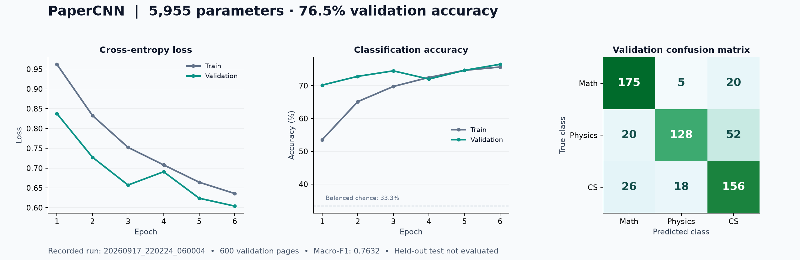

<div align="center">

# PaperCNN

**从论文首页图像预测学科 · Classifying research fields from paper first pages**


[中文](#中文) · [English](#english) · [数据格式 / Dataset](docs/DATASET.md) · [实验记录 / Experiments](docs/EXPERIMENTS.md) · [线索消融 / Cue ablations](docs/EXPERIMENTS.md#geometry-and-saved-settings)

</div>

## 中文

PaperCNN 是一个完整的小型 PyTorch 图像分类项目：输入一张论文首页，预测 `math`（数学）、`physics`（物理）或 `cs`（计算机科学）。项目使用两层卷积和空间池化，包含数据检查、训练、模型保存与恢复、单图预测和分割集评估。

模型只有 **5,955 个可训练参数**。已有五次实验中，最佳模型在固定的 **600 张验证图片**上取得 **76.50% 准确率、0.7632 macro-F1**。这属于验证结果；**目前没有最终测试集成绩**。本项目展示的是可检查的学习实验，不据此主张模型理解了论文内容或仅依赖页面版式。



### 快速开始

已在 Python 3.12 环境验证。以下命令适用于 macOS / Linux：

```bash
git clone https://github.com/BrookWW/PaperCNN.git
cd PaperCNN
python3 -m venv .venv
source .venv/bin/activate
python -m pip install --upgrade pip
python -m pip install -r requirements.txt

# 不需要数据即可检查模型和单批训练 / Check the model and one-batch training without data
python check.py --part model
python check.py --part step
```

Windows 可用 `.venv\Scripts\Activate.ps1` 激活环境，并用 PowerShell 的 `$env:ARXIV_DATA_ROOT = "C:\path\to\arxiv"` 设置后文的数据路径。

仓库附带最佳运行的轻量 checkpoint [`checkpoints/papercnn.pt`](checkpoints/papercnn.pt)，**不附带论文图片或原始 CSV**。安装依赖后，可以直接预测自己的首页图片：

```bash
python predict.py --checkpoint checkpoints/papercnn.pt --image "/path/to/page.png"
```

要训练或评估数据集，请先按[数据说明](docs/DATASET.md)准备数据，然后运行：

```bash
# 替换为包含 CSV 和 images/ 的目录 / Replace with the directory containing CSVs and images/
export ARXIV_DATA_ROOT="/path/to/arxiv"

# 检查数据清单、模型和训练步骤 / Check dataset manifests, model, and training step
python check.py --data-root "$ARXIV_DATA_ROOT"

# 默认：5 轮、batch 16、CPU / Defaults: 5 epochs, batch size 16, CPU
python train.py --data-root "$ARXIV_DATA_ROOT"

# 使用最佳历史运行的超参数 / Use the hyperparameters of the best recorded run
python train.py --data-root "$ARXIV_DATA_ROOT" --epochs 6 --lr 0.003 --weight-decay 0.0003
```

`ARXIV_DATA_ROOT` 设置训练和检查的默认数据目录；未设置时默认使用仓库下的 `data/`。`--data-root` 可显式覆盖。默认设备为 CPU；机器支持时可传入 `--device mps` 或 `--device cuda`。不同设备、依赖版本或数据可能得到不同结果。

### 模型与训练方式

预处理按原比例缩放图片，并以白色补齐到 **高 128 × 宽 96**。图片转为单通道灰度，再计算 `1 - pixel / 255`，得到白底为 0、黑色墨迹为 1 的输入。无需 OCR，也不读取论文正文文本。

| 阶段 | 操作 | 输出形状 | 参数数 |
|---|---|---|---:|
| 输入 | 灰度与归一化 | `N × 1 × 128 × 96` | 0 |
| 卷积块 1 | `Conv2d(1,16,3,padding=1)` → ReLU → MaxPool 2×2 | `N × 16 × 64 × 48` | 160 |
| 卷积块 2 | `Conv2d(16,32,3,padding=1)` → ReLU → MaxPool 2×2 | `N × 32 × 32 × 24` | 4,640 |
| 空间汇总 | AdaptiveAvgPool 4×3 → Flatten | `N × 384` | 0 |
| 分类器 | Linear 384→3 | `N × 3` 原始分数 | 1,155 |
| **合计** | | | **5,955** |

4×3 池化网格保留粗粒度空间位置，同时控制全连接层参数量。训练采用平均交叉熵与 Adam；`weight_decay` 只作用于权重，偏置不衰减。模型输出 logits；单图预测时才转换成 softmax 分数。这些分数没有经过概率校准。

### 已有实验结果

所有运行使用相同的 2,400 张训练图、600 张验证图、模型种子 `1718` 和划分种子 `231`，batch size 为 16，设备为 CPU。表中准确率和 macro-F1 均来自**验证准确率最高的 checkpoint 重新加载后**的评估。

| 运行 ID | 训练轮数 | 学习率 | 权重衰减 | 最佳轮次 | 验证准确率 | 验证 macro-F1 |
|---|---:|---:|---:|---:|---:|---:|
| [20260917_213349_662886](experiments/20260917_213349_662886) | 1 | 0.001 | 0.0001 | 1 | 68.83% | 0.6792 |
| [20260917_214331_444406](experiments/20260917_214331_444406) | 5 | 0.001 | 0.0001 | 4 | 74.17% | 0.7357 |
| [20260917_215931_498194](experiments/20260917_215931_498194) | 5 | 0.003 | 0.0001 | 3 | 74.67% | 0.7423 |
| [20260917_220128_289022](experiments/20260917_220128_289022) | 5 | 0.003 | 0.0003 | 5 | 74.67% | 0.7465 |
| [20260917_220224_060004](experiments/20260917_220224_060004) | 6 | 0.003 | 0.0003 | 6 | **76.50%** | **0.7632** |

三类平衡时，始终预测一个类别的准确率为 33.33%，这是理论参照值。表中结果不是独立多种子实验的均值；重复使用同一验证集调参，不能将最佳值当作无偏的泛化性能估计。完整指标、混淆矩阵和限制见[实验说明](docs/EXPERIMENTS.md)。

### 预测与评估

可直接使用仓库附带的最佳 checkpoint。自行训练后，也可将路径换成训练生成的 `runs/<run_id>/best.pt`：

```bash
# 使用随仓库提供的最佳模型 / Use the included best checkpoint
CHECKPOINT="checkpoints/papercnn.pt"

# 单张首页预测 / Predict a single first-page image
python predict.py --checkpoint "$CHECKPOINT" --image "/path/to/page.png"

# 用 checkpoint 保存的固定划分评估验证集 / Evaluate the validation split saved in the checkpoint
python predict.py --checkpoint "$CHECKPOINT" --split val --data-root "$ARXIV_DATA_ROOT"

# 选定模型后再使用最终测试集 / Evaluate the held-out test set after selecting the model
python predict.py --checkpoint "$CHECKPOINT" --split test --data-root "$ARXIV_DATA_ROOT"
```

推理读取 checkpoint 中保存的输入尺寸、标签顺序和验证清单。标签编号固定为 `math=0, physics=1, cs=2`。评估输出交叉熵、准确率、macro-F1、样本数和混淆矩阵；矩阵行表示真实类别，列表示预测类别。

### 数据与文件结构

| 划分 | math | physics | cs | 合计 |
|---|---:|---:|---:|---:|
| 训练 | 800 | 800 | 800 | 2,400 |
| 验证 | 200 | 200 | 200 | 600 |
| 保留测试 | 300 | 300 | 300 | 900 |

训练/验证从 `train.csv` 的 3,000 条记录中固定分层划分；`test.csv` 的 900 条记录单独保留。训练不读取测试图片。完整数据检查会读取测试清单及文件信息，并抽查每类一张训练图片，不进行测试集推理。

```text
PaperCNN/
├── model.py                 # 模型与单批训练 / Model and one-batch training
├── data.py                  # CSV、划分和图片预处理 / CSVs, splits, and preprocessing
├── train.py                 # 训练、验证与保存 / Training, validation, and saving
├── predict.py               # 单图预测与评估 / Image prediction and evaluation
├── check.py                 # 数据、结构与梯度检查 / Data, structure, and gradient checks
├── config.py                # 默认设置 / Default settings
├── requirements.txt         # 可安装的依赖范围 / Installable dependency ranges
├── requirements-lock.txt    # 历史运行的核心版本 / Core versions from historical runs
├── checkpoints/             # 已训练的最佳模型与来源说明 / Best trained model and provenance
├── tests/                   # 使用合成数据的流程测试 / Pipeline tests with synthetic data
├── docs/                    # 双语文档与结果图 / Bilingual guides and results figure
├── experiments/             # 五次历史运行的 JSON / JSON records of five historical runs
├── data/                    # 自行提供；不提交 / User-supplied, ignored by Git
└── runs/                    # 本地生成；不提交 / Generated locally, ignored by Git
```

每次训练保存 `config.json`、`split.json`、`history.json`、`summary.json`、`curves.png` 和 `best.pt`。仓库中的 `experiments/` 保留了历史配置、逐轮指标、划分清单和摘要，并将原始机器的数据绝对路径替换为可移植占位路径。原始图片不分发；最佳运行的 checkpoint 单独保存在 `checkpoints/`，导出时仅将数据根目录改为 `data`，模型参数与划分保持不变。历史核心依赖版本保存在 `requirements-lock.txt`；它不是完整环境锁文件，使用相同版本也不保证跨平台逐位一致。

### 检查与测试

```bash
python check.py --part model
python check.py --part step
python -m unittest discover -s tests -v
```

五项自动测试使用合成图片验证训练、保存/恢复、预测等流程及划分重叠防护，无需下载原始数据。GitHub Actions 已配置在 Python 3.12 CPU 环境运行这些检查。它们验证代码流程，不替代真实数据上的精度评估。

页面中可能含标题、作者、模板、公式和其他相关线索；当前实验没有做消融或跨来源验证来区分这些线索的作用。论文权利、图像获取方式及你所用数据的分发许可需要分别确认；本仓库没有为外部论文内容授予许可。

---

## English

PaperCNN is a complete, compact PyTorch image classification project. Given the first page of a research paper, it predicts one of three fields: `math`, `physics`, or `cs`. Two convolutional layers and spatial pooling are supported by dataset checks, training, checkpoint saving and restoration, single-image prediction, and split evaluation.

The model has **5,955 trainable parameters**. Across five recorded runs, the best checkpoint reached **76.50% accuracy and 0.7632 macro-F1 on a fixed 600-image validation set**. These are validation results; **no held-out test result is currently reported**. This is an inspectable learning experiment, without claims that the model understands papers or relies exclusively on page layout.


### Quick start

Verified locally with Python 3.12. The following commands target macOS / Linux:

```bash
git clone https://github.com/BrookWW/PaperCNN.git
cd PaperCNN
python3 -m venv .venv
source .venv/bin/activate
python -m pip install --upgrade pip
python -m pip install -r requirements.txt

# 无需数据 / No dataset required
python check.py --part model
python check.py --part step
```

On Windows, activate the environment with `.venv\Scripts\Activate.ps1` and set the dataset directory in PowerShell with `$env:ARXIV_DATA_ROOT = "C:\path\to\arxiv"`.

The best recorded model is included as [`checkpoints/papercnn.pt`](checkpoints/papercnn.pt). **Paper images and original CSVs are not included.** After installing dependencies, predict your own first-page image directly:

```bash
python predict.py --checkpoint checkpoints/papercnn.pt --image "/path/to/page.png"
```

To train or evaluate a dataset, follow the [dataset guide](docs/DATASET.md), then run:

```bash
# 包含 CSV 和 images/ 的目录 / Directory containing CSVs and images/
export ARXIV_DATA_ROOT="/path/to/arxiv"

# 检查数据、模型及训练步骤 / Check data, model, and training step
python check.py --data-root "$ARXIV_DATA_ROOT"

# 默认训练设置 / Default training settings
python train.py --data-root "$ARXIV_DATA_ROOT"

# 最佳历史运行的超参数 / Hyperparameters of the best recorded run
python train.py --data-root "$ARXIV_DATA_ROOT" --epochs 6 --lr 0.003 --weight-decay 0.0003
```

`ARXIV_DATA_ROOT` sets the default dataset directory for training and checks; without it, the default is `data/` inside the repository. Use `--data-root` to override it explicitly. Training defaults to **5 epochs**, batch size **16**, learning rate **0.003**, weight decay **0.0003**, and **CPU**. Pass `--device mps` or `--device cuda` on supported hardware. Results may vary with hardware, dependency versions, or data.

### Architecture and training

Each image is resized with its aspect ratio preserved and padded with white to **128 pixels high × 96 pixels wide**. It is converted to grayscale and transformed using `1 - pixel / 255`, so white background becomes 0 and black ink becomes 1. The pipeline uses neither OCR nor extracted paper text.

| Stage | Operation | Output shape | Parameters |
|---|---|---|---:|
| Input | Grayscale and normalization | `N × 1 × 128 × 96` | 0 |
| Convolution block 1 | `Conv2d(1,16,3,padding=1)` → ReLU → MaxPool 2×2 | `N × 16 × 64 × 48` | 160 |
| Convolution block 2 | `Conv2d(16,32,3,padding=1)` → ReLU → MaxPool 2×2 | `N × 32 × 32 × 24` | 4,640 |
| Spatial readout | AdaptiveAvgPool 4×3 → Flatten | `N × 384` | 0 |
| Classifier | Linear 384→3 | `N × 3` logits | 1,155 |
| **Total** | | | **5,955** |

The 4×3 readout retains coarse spatial position while limiting the size of the classifier. Training uses mean cross-entropy and Adam. Weight decay applies to weights only, with no decay on biases. The network returns logits; single-image prediction converts these to softmax scores, which have not been calibrated as probabilities.

### Recorded results

Every run used the same 2,400 training images and 600 validation images, model seed `1718`, split seed `231`, batch size 16, and CPU execution. Accuracy and macro-F1 below come from reevaluating the **reloaded checkpoint selected by highest validation accuracy**.

| Run ID | Epochs | Learning rate | Weight decay | Best epoch | Val. accuracy | Val. macro-F1 |
|---|---:|---:|---:|---:|---:|---:|
| [20260917_213349_662886](experiments/20260917_213349_662886) | 1 | 0.001 | 0.0001 | 1 | 68.83% | 0.6792 |
| [20260917_214331_444406](experiments/20260917_214331_444406) | 5 | 0.001 | 0.0001 | 4 | 74.17% | 0.7357 |
| [20260917_215931_498194](experiments/20260917_215931_498194) | 5 | 0.003 | 0.0001 | 3 | 74.67% | 0.7423 |
| [20260917_220128_289022](experiments/20260917_220128_289022) | 5 | 0.003 | 0.0003 | 5 | 74.67% | 0.7465 |
| [20260917_220224_060004](experiments/20260917_220224_060004) | 6 | 0.003 | 0.0003 | 6 | **76.50%** | **0.7632** |

With balanced classes, always predicting one class yields 33.33% accuracy as a theoretical reference. These runs are not independent multi-seed averages. The fixed validation set was reused for tuning, so the best result is not an unbiased estimate of generalization. See the [experiment guide](docs/EXPERIMENTS.md) for full metrics, the confusion matrix, and limitations.

### Prediction and evaluation

Use the included best checkpoint directly. After training your own model, you can replace its path with the generated `runs/<run_id>/best.pt`:

```bash
# 使用随仓库提供的最佳模型 / Use the included best checkpoint
CHECKPOINT="checkpoints/papercnn.pt"

# 单图预测 / Predict one image
python predict.py --checkpoint "$CHECKPOINT" --image "/path/to/page.png"

# 固定验证集 / Saved validation split
python predict.py --checkpoint "$CHECKPOINT" --split val --data-root "$ARXIV_DATA_ROOT"

# 完成模型选择后评估测试集 / Evaluate the test set after model selection
python predict.py --checkpoint "$CHECKPOINT" --split test --data-root "$ARXIV_DATA_ROOT"
```

Inference uses the image size, label order, and validation records saved inside the checkpoint. Label IDs are always `math=0, physics=1, cs=2`. Evaluation reports cross-entropy, accuracy, macro-F1, sample count, and a confusion matrix with true labels as rows and predictions as columns.

### Dataset and repository

| Split | math | physics | cs | Total |
|---|---:|---:|---:|---:|
| Training | 800 | 800 | 800 | 2,400 |
| Validation | 200 | 200 | 200 | 600 |
| Held-out test | 300 | 300 | 300 | 900 |

A fixed stratified split partitions the 3,000 records in `train.csv` into training and validation sets. The 900 records in `test.csv` remain separate. Training does not open test images. The full dataset check reads test metadata and checks file existence; it opens one training image per class and does not run test inference.

| Path | Purpose |
|---|---|
| [`model.py`](model.py) | CNN and the one-batch training update |
| [`data.py`](data.py) | CSV validation, fixed splitting, image loading |
| [`train.py`](train.py) | Training, validation, checkpoint selection, plots |
| [`predict.py`](predict.py) | Single-image prediction and split evaluation |
| [`check.py`](check.py) | Dataset, model structure, and gradient checks |
| [`config.py`](config.py) | Default configuration |
| [`requirements.txt`](requirements.txt) | Installable dependency ranges |
| [`requirements-lock.txt`](requirements-lock.txt) | Historical core package versions |
| [`checkpoints/`](checkpoints) | Best trained checkpoint and provenance |
| [`tests/`](tests) | Pipeline tests with synthetic data |
| [`docs/`](docs) | Bilingual guides and results figure |
| [`experiments/`](experiments) | JSON records from all five historical runs |
| `data/` | User-supplied dataset, ignored by Git |
| `runs/` | Locally generated training outputs, ignored by Git |

Each training run saves `config.json`, `split.json`, `history.json`, `summary.json`, `curves.png`, and `best.pt`. The versioned `experiments/` directories contain the historical configurations, per-epoch metrics, split records, and summaries. Machine-specific absolute data paths have been replaced with a portable placeholder. Source images are not distributed. The best checkpoint is supplied separately in `checkpoints/`; export changes only its dataset root to `data`, preserving model parameters and split records. Historical core package versions are recorded in `requirements-lock.txt`; this is not a complete environment lockfile, and matching versions does not guarantee bitwise reproducibility across platforms.

### Checks and tests

```bash
python check.py --part model
python check.py --part step
python -m unittest discover -s tests -v
```

Five automated tests use synthetic images to exercise training, saving/restoration, prediction, and split-overlap protection without the original dataset. GitHub Actions is configured to run these checks with Python 3.12 on CPU. They verify the code pipeline and do not replace accuracy evaluation on real data.

First pages may contain titles, author names, templates, equations, and other predictive cues. No ablation or cross-source evaluation has isolated their effects. Paper rights, image acquisition, and permission to distribute your dataset must be considered separately; this repository grants no rights to external paper content.
