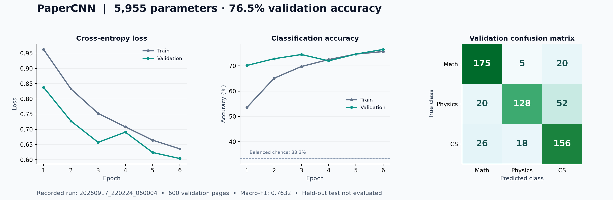

# 实验记录 / Experiment report

[返回 README / Back to README](../README.md) · [中文](#中文) · [English](#english)

## 中文

本页汇总 2026 年 9 月 17 日保存的五次实际训练。数据源为 `experiments/<run_id>/` 下的 `config.json`、`history.json`、`summary.json` 和 `split.json`。展示用图由已保存的指标绘制，没有补造训练结果。

### 固定设置与选择规则

所有运行使用同一个 5,955 参数的 CNN、灰度 128×96 输入、batch size 16、CPU、模型种子 `1718` 和划分种子 `231`。每次运行从头初始化模型，不是前一次 checkpoint 的续训。训练集为 2,400 张，验证集为 600 张，三类均衡。

训练优化器为 Adam，权重衰减仅作用于权重；损失是平均交叉熵。每轮训练指标累计该轮各批参数更新前的预测，因此它们不等于该轮结束后对训练集重新评估的结果。验证指标在该轮训练结束后计算。程序按验证准确率选择 checkpoint，只有严格提高时才更新；并列时保留较早轮次。macro-F1 不是 checkpoint 选择标准。

### 全部运行

| 运行 ID | 总轮数 | 学习率 | 权重衰减 | 最佳轮次 | 验证准确率 | 验证 macro-F1 | 验证交叉熵 |
|---|---:|---:|---:|---:|---:|---:|---:|
| [20260917_213349_662886](../experiments/20260917_213349_662886) | 1 | 0.001 | 0.0001 | 1 | 68.83% | 0.679176 | 0.845355 |
| [20260917_214331_444406](../experiments/20260917_214331_444406) | 5 | 0.001 | 0.0001 | 4 | 74.17% | 0.735720 | 0.679696 |
| [20260917_215931_498194](../experiments/20260917_215931_498194) | 5 | 0.003 | 0.0001 | 3 | 74.67% | 0.742317 | 0.641020 |
| [20260917_220128_289022](../experiments/20260917_220128_289022) | 5 | 0.003 | 0.0003 | 5 | 74.67% | 0.746539 | 0.623949 |
| [20260917_220224_060004](../experiments/20260917_220224_060004) | 6 | 0.003 | 0.0003 | 6 | **76.50%** | **0.763223** | **0.604041** |

这些指标取自每个 `summary.json` 的 `restored_val`，即重新加载最佳 checkpoint 后的验证结果。所有摘要均记录 `reload_logits_match=true` 和 `test_set_used=false`。前者表示保存/恢复后的同批 logits 通过数值容差比较，不代表所有平台均逐位一致。

### 最佳运行：20260917_220224_060004



最佳轮次为第 6 轮；600 个验证样本中正确分类 **459 个**。混淆矩阵的行是真实类别，列是预测类别：

| 真实类别 ↓ / 预测类别 → | math | physics | cs | 召回率 |
|---|---:|---:|---:|---:|
| math | 175 | 5 | 20 | 87.5% |
| physics | 20 | 128 | 52 | 64.0% |
| cs | 26 | 18 | 156 | 78.0% |

在这批验证样本中，物理的召回率最低，其中 52/200 被预测为计算机科学。该观察描述模型的错误分布，不说明产生错误的因果机制。

可使用以下命令运行相同超参数：

```bash
python train.py --data-root "/path/to/arxiv" --epochs 6 --batch-size 16 --lr 0.003 --weight-decay 0.0003 --device cpu
```

请提供相同图片与清单，并保留 `config.py` 中的模型种子、划分种子和预处理。默认训练轮数为 5，复现此运行必须显式传入 `--epochs 6`。

### 保存内容与复现边界

| 文件 | 内容 |
|---|---|
| `config.json` | 实际超参数、种子、图像尺寸、类别顺序、样本数和 PyTorch 版本 |
| `split.json` | 训练/验证相对图片路径、标签、划分参数及原始 `train.csv` 的 SHA-256 |
| `history.json` | 每轮训练与验证指标，包括验证混淆矩阵 |
| `summary.json` | 最佳轮次、最佳模型重载后的验证指标和测试集使用标记 |

公开实验记录将机器特定的数据绝对路径替换为 `<ARXIV_DATA_ROOT>`；指标和划分记录保留。原始图片不分发；最佳运行的 checkpoint 单独保存在 [`checkpoints/papercnn.pt`](../checkpoints/papercnn.pt)，仅将数据根目录替换为 `data`。导出的权重已与原始权重逐项核对，并在同一真实验证集上重新评估，得到相同的损失、准确率、macro-F1 和混淆矩阵。`requirements-lock.txt` 记录了历史环境的核心包版本，但不包含所有传递依赖、操作系统或硬件状态。新的 `requirements.txt` 提供安装范围，不能据此保证完全复现历史数值。

当前证据的限制：

- **没有最终测试结果。** 900 张测试图片被保留；上述准确率只针对用于模型选择的验证集。
- **只有一个模型种子和一个划分种子。** 没有多次独立随机试验、误差条或显著性检验。小幅差异不足以证明某个超参数普遍更优。
- **同一验证集被重复用于调参。** 最佳值可能受选择偏差影响；需要锁定模型后进行独立测试。
- **没有跨来源验证或线索消融。** 首页标题、模板、作者、公式等都可能提供相关信息，不能将表现解释为纯版式识别或内容理解。
- **CSV 哈希不等于图像哈希。** 相同清单不能保证图片字节相同；严格复现还需要保存并核对图片内容及环境信息。

---

## English

This report summarizes five actual runs saved on September 17, 2026. Evidence comes from `config.json`, `history.json`, `summary.json`, and `split.json` under `experiments/<run_id>/`. The presentation figure is drawn from saved metrics; no training results have been synthesized.

### Shared settings and selection rule

All runs used the same 5,955-parameter CNN, grayscale 128×96 inputs, batch size 16, CPU execution, model seed `1718`, and split seed `231`. Each run initialized a new model rather than resuming the previous checkpoint. The training and validation sets contained 2,400 and 600 images respectively, with balanced classes.

Training used Adam, weight decay on weights only, and mean cross-entropy. Training metrics aggregate each batch's predictions before its parameter update. They are not a fresh evaluation of the full training set at the end of an epoch. Validation occurs after each epoch. The checkpoint is selected by validation accuracy and updated only on a strict improvement, retaining the earlier epoch in a tie. Macro-F1 is not the checkpoint selection criterion.

### All recorded runs

| Run ID | Epochs | Learning rate | Weight decay | Best epoch | Val. accuracy | Val. macro-F1 | Val. cross-entropy |
|---|---:|---:|---:|---:|---:|---:|---:|
| [20260917_213349_662886](../experiments/20260917_213349_662886) | 1 | 0.001 | 0.0001 | 1 | 68.83% | 0.679176 | 0.845355 |
| [20260917_214331_444406](../experiments/20260917_214331_444406) | 5 | 0.001 | 0.0001 | 4 | 74.17% | 0.735720 | 0.679696 |
| [20260917_215931_498194](../experiments/20260917_215931_498194) | 5 | 0.003 | 0.0001 | 3 | 74.67% | 0.742317 | 0.641020 |
| [20260917_220128_289022](../experiments/20260917_220128_289022) | 5 | 0.003 | 0.0003 | 5 | 74.67% | 0.746539 | 0.623949 |
| [20260917_220224_060004](../experiments/20260917_220224_060004) | 6 | 0.003 | 0.0003 | 6 | **76.50%** | **0.763223** | **0.604041** |

These metrics come from `restored_val` in each `summary.json`: an evaluation of the reloaded best checkpoint. All summaries record `reload_logits_match=true` and `test_set_used=false`. The first flag means logits for a probe batch matched within the configured numerical tolerance after saving and restoration; it does not establish bitwise identity across platforms.

### Best run: 20260917_220224_060004


Epoch 6 was selected, with **459 correct predictions out of 600 validation images**. Rows are true labels and columns are predicted labels:

| True label ↓ / Prediction → | math | physics | cs | Recall |
|---|---:|---:|---:|---:|
| math | 175 | 5 | 20 | 87.5% |
| physics | 20 | 128 | 52 | 64.0% |
| cs | 26 | 18 | 156 | 78.0% |

Physics had the lowest recall on this validation set; 52 of its 200 images were predicted as computer science. This describes the observed errors without establishing their cause.

Run the same hyperparameters with:

```bash
python train.py --data-root "/path/to/arxiv" --epochs 6 --batch-size 16 --lr 0.003 --weight-decay 0.0003 --device cpu
```

Supply identical images and manifests and retain the model seed, split seed, and preprocessing in `config.py`. Default training lasts 5 epochs, so this run requires the explicit `--epochs 6` override.

### Saved evidence and reproducibility limits

| File | Contents |
|---|---|
| `config.json` | Actual hyperparameters, seeds, image size, label order, sample counts, and PyTorch version |
| `split.json` | Relative training/validation image paths, labels, split parameters, and SHA-256 of the original `train.csv` |
| `history.json` | Per-epoch training and validation metrics, including validation confusion matrices |
| `summary.json` | Best epoch, reloaded validation metrics, and test-set usage flag |

Machine-specific absolute dataset paths have been replaced with `<ARXIV_DATA_ROOT>` in the public experiment records; metrics and split records are retained. Source images are not included. The best checkpoint is provided separately as [`checkpoints/papercnn.pt`](../checkpoints/papercnn.pt), with only its data root changed to `data`. Exported model tensors were compared with the originals, and reevaluation on the same real validation set recovered identical loss, accuracy, macro-F1, and confusion matrix. `requirements-lock.txt` records historical core package versions, but not every transitive dependency, operating system detail, or hardware setting. The installation ranges in `requirements.txt` do not guarantee exact historical numbers.

Limitations of the available evidence:

- **No held-out test result.** The 900 test images were reserved. Reported accuracy is measured on the validation set used for model selection.
- **One model seed and one split seed.** There are no independent multi-seed trials, error bars, or significance tests. Small differences do not establish that a hyperparameter choice is generally better.
- **Repeated reuse of the same validation set.** Selection bias may affect the best result; independent testing is needed after fixing the model.
- **No cross-source evaluation or cue ablations.** Titles, templates, author names, equations, and other cues may contribute. Performance does not establish exclusive reliance on layout or understanding of paper content.
- **A CSV hash is not an image hash.** Identical manifests do not guarantee identical image bytes. Strict reproduction also requires image integrity checks and environment records.

## 可复现的线索消融框架 / Reproducible cue-ablation framework

新增框架支持以下确定性变换；**尚未运行真实论文数据的消融实验，没有消融准确率或准确率变化结果**。上面的历史记录保持不变，仍无跨来源评估或线索消融证据。`body-only` 是几何裁剪的名称，不保证只保留正文，也不检测标题、作者或公式。

The framework now supports these deterministic transforms. **No ablation experiment on real paper data has been run for this change, and no ablation accuracy or accuracy delta is reported.** Historical evidence above is unchanged; it still contains no cross-source evaluation or cue-ablation results. `body-only` names a geometric crop, not semantic body detection.

### Geometry and saved settings

All operations act on the original grayscale page **before** the existing aspect-preserving resize, white padding, and conversion to float32 ink (`1 - pixel/255`). Coordinates are independent of labels, split membership, learned statistics, and random seeds. Let `H` be the source page height; pixel intervals below exclude the upper endpoint.

| `--ablation` | Version 1 operation | Interpretation |
|---|---|---|
| `none` (training default) | Keep the complete page | Original preprocessing, unchanged |
| `top-strip` | Fill rows `[0, ceil(0.25 * H))` with white (255), preserving source dimensions | Remove the upper quarter without enlarging remaining content |
| `body-only` | Keep full width and rows `[floor(0.25 * H), max(floor(0.25 * H) + 1, floor(0.90 * H)))` | Remove upper and lower regions; resizing the crop also changes scale and padding |

The minimum one-row crop makes tiny synthetic images well-defined. These regions can remove body text or retain titles/authors depending on the page. Templates and equations can remain in either mode. Neither mode isolates a single semantic cue, proves causal reliance on that cue, or provides cross-source evaluation.

训练与验证使用相同变换，划分与种子不变。`config.json`、`best.pt`、`summary.json` 保存完整 `ablation` 字典（模式、版本、执行阶段、几何参数及取整规则）。预测默认继承 checkpoint 设置；旧 checkpoint 缺少此字段时采用 `none`。显式覆盖时，报告保存训练和预测设置以及是否一致，避免混淆重新训练与预测阶段的扰动。

Training and validation use the same setting through `data.load_image()`. Splitting and random seeds are unaffected. New `config.json`, `best.pt`, and `summary.json` files record a complete `ablation` dictionary: mode, version, processing stage, and applicable geometry, rounding, and fill value. Existing historical records are not rewritten. Prediction inherits the checkpoint setting unless `--ablation` is explicit. A legacy checkpoint without ablation metadata uses `none`; unsupported/inconsistent metadata is rejected rather than silently interpreted.

Single-image, validation, and test reports include `training_ablation`, effective `ablation`, `ablation_override`, and `preprocessing_matches_training`. `--output-json` saves that same report; its parent directory must already exist. Passing an explicit matching mode records an override with matching preprocessing; a different mode records a mismatch. Applying masking to a full-page checkpoint is a prediction-time sensitivity probe, a different experiment from retraining with masked input.

### Run a matched comparison when the dataset is available

Supply actual images and manifests in the documented [dataset format](DATASET.md), keep `config.py` seeds, image size, split parameters, environment, and hyperparameters fixed, and train a fresh model for each setting:

```bash
for mode in none top-strip body-only; do
  python train.py --data-root "$ARXIV_DATA_ROOT" --epochs 6 --batch-size 16 \
    --lr 0.003 --weight-decay 0.0003 --device cpu --ablation "$mode"
done
```

Each invocation writes a separate directory in `runs/`. Associate directories using their saved ablation metadata. Check that `split.json` files have identical training/validation rows and CSV hash. Preserve source image hashes, repository revision, and dependency/environment information alongside the runs; the CSV hash alone cannot establish identical inputs. GPU/backend differences can still prevent bitwise numerical reproducibility. The transforms themselves are deterministic for the same image bytes and preprocessing library versions.

For each completed run, inspect `summary.json` and evaluate its checkpoint with inherited preprocessing:

```bash
python predict.py --checkpoint runs/<run_id>/best.pt --split val \
  --data-root "$ARXIV_DATA_ROOT" --output-json validation_report.json
```

To probe the published full-page checkpoint with masking, explicitly request the override:

```bash
python predict.py --checkpoint checkpoints/papercnn.pt --image /path/to/page.png \
  --ablation top-strip --output-json masked_prediction.json
```

Keep prediction-time probes separate from matched retraining comparisons. Use validation only for development; lock the experiment settings before evaluating reserved test data. To evaluate a locked checkpoint, replace `--split val` with `--split test`. The existing paper/version overlap checks apply in every mode. Report measured accuracy, macro-F1, confusion matrices, and differences only from retained actual run artifacts. A single paired seed does not support significance or generalization claims; additional seeds and cross-source data require separate experiments.

### Synthetic regression checks

```bash
python -m unittest discover -s tests -v
```

The tests use generated pages to check exact region boundaries (including odd heights and one-pixel pages), transform-before-resize ordering, unchanged source bytes, repeatability, tensor shape/type/range, unchanged splits, train/validation/test propagation, saved metadata, checkpoint reload, prediction overrides, legacy defaults, and invalid-setting rejection. Synthetic training is an integration check, **not evidence of accuracy on papers**.
